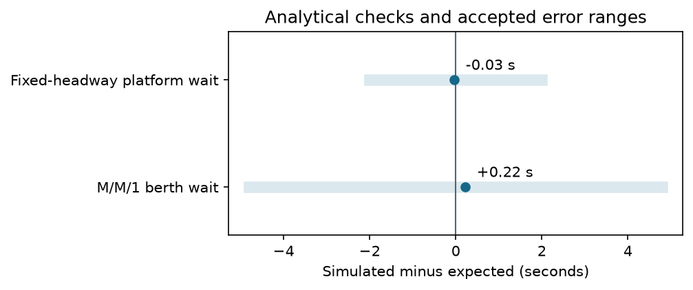

# Bus Corridor Simulator

Compare faster boarding and capped upstream holding on a six-stop bus corridor.

[Open the live demo](https://amri0faz31.github.io/bus-corridor-simulator/)

## The question

When buses arrive close together, they can queue for the same boarding space. Buses that arrive after a long gap can also take longer to board waiting passengers, which lets the next bus catch up. Under different passenger demand and travel-time variability, does faster boarding reduce mean passenger journey time more than capped holding before Market?

## Quick start

- **Colab.** Open the notebook using the badge above and select **Runtime → Run all**.
- **Local Python.** From the repository root, install dependencies with `python -m pip install -r requirements.txt`. Open [the notebook](notebook/bus-corridor-simulator.ipynb) in Jupyter and run all cells.
- **Browser.** Use the live demo link above or open `docs/index.html` in Chrome, Edge or Firefox.

## User guide

Use **Start**, **Pause** and **Reset** on the shared clock. Change demand, travel-time variability or the cap to compare three configurations. Choose **Original road disruption** under **Scenario options** and jump to **7:10** to see Bus 5’s wait move upstream with holding. [Full user guide](USER_GUIDE.md)

## Model and mathematics

The corridor has five road links and one bus berth at each stop. A priority queue advances the clock to the next event. Passenger arrivals follow Poisson processes and sampled road running times are lognormal. At each stop, dwell is a fixed time plus a boarding term and an alighting term. The stochastic experiment uses mean link times of 104, 98, 85, 71 and 69 s from Herath et al. (2024), Road 1, Table 4. The faster boarding policy uses 1.7088 s per boarding passenger instead of 2.136 s, a hypothetical 20% reduction at all boarding stops.

If $g$ is the time since the preceding control release, the deliberate hold is $h=\min(h_{\max},\max(0,H-g))$. The main comparison uses an 80-second target $H$ and a 20-second cap $h_{\max}$. Passenger journey time runs from platform arrival to the start of alighting at the destination. It includes platform waiting, movement, queues, applicable dwell and holding. [Equations and assumptions](THEORY.md)

## Verification

The simulated mean berth wait was **60.22 s** against the M/M/1 benchmark of **60.00 s**. Mean passenger wait at a fixed 80-second headway was **39.97 s** against the expected **40.00 s**. Hand-traced fixtures check FIFO ordering, passenger completion, and equivalence at zero hold. The original stochastic metrics, zero boarding improvement and both browser replays also pass their regression checks. [Verification details](VERIFICATION.md)

## Concepts applied

- Next-event discrete-event simulation represents bus movement, passenger boarding and berth occupancy.
- Queueing theory provides independent verification targets for berth and passenger waiting.
- Inverse-transform sampling generates exponential passenger inter-arrival times.
- Paired Monte Carlo replications reuse the same passenger trips and road draws within each policy pair. Replication-level differences provide 95% confidence intervals.

## Results, limitations and future work

The study completed 540 runs, using 30 matched replications of all three policies per scenario. Faster boarding shortened mean journeys by **3.50–93.70 s per passenger compared with capped holding**, with paired intervals favouring faster boarding in all six scenarios. Holding reduced mean journey time compared with baseline at low and medium demand. Its journey-time effects at high demand were uncertain, though it reduced platform waiting and improved departure spacing at Market.

The published-parameter scenario uses measured link means and dwell coefficients alongside assumed dispatches, demand, destinations, variability and stop layout. Faster boarding assumes a service improvement across the route. The fixed 100-second road disruption remains a separate illustration. [Results and exports](RESULTS.md) · [Experiment design](EXPERIMENT_PLAN.md)

## Key references

Daganzo (2009) studies headway-based control. Shen et al. (2026) examine the feedback between berth queues and irregular headways. Herath et al. (2024) provide Sri Lankan link means and a boarding-and-alighting dwell model. [Full references and DOIs](REFERENCES.md)

## AI assistance

AI assisted with planning, code, debugging, figures and documentation. The notebook and test scripts contain the reproducible checks used to evaluate the implementation.

## Licence and data credits

[MIT licence](LICENSE) · [Data sources, assumptions and licences](data/README.md)
