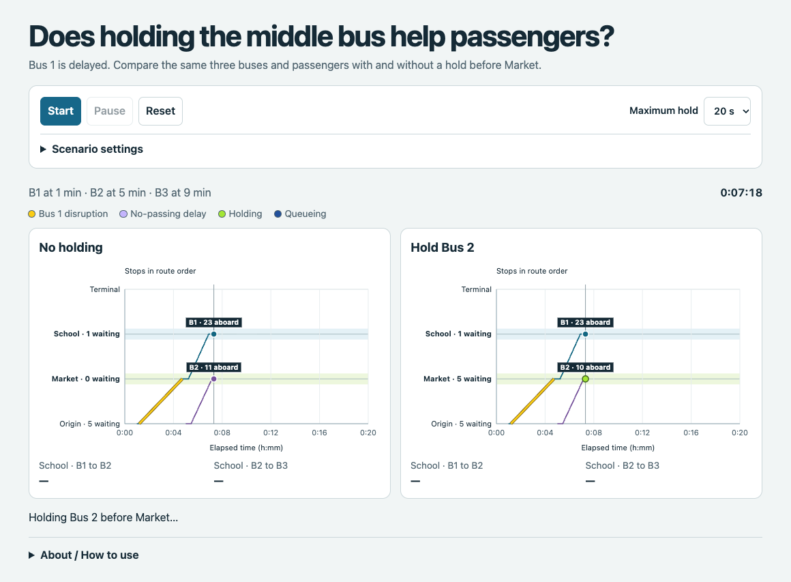
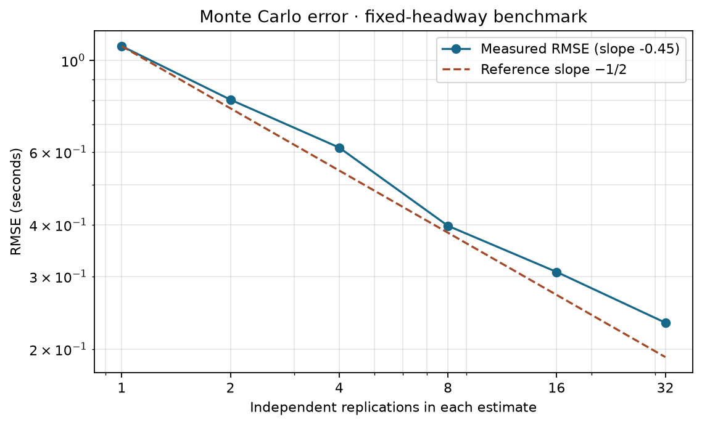

# How much should the middle bus be held?

After a two-minute delay to Bus 1, compare maximum holds of 0, 20, 40 and 60 seconds for Bus 2. The outcome is mean passenger journey time from arrival at the stop to alighting.

[Open the live demo](https://amri0faz31.github.io/bus-corridor-simulator/)

## The question

How does the allowed hold affect passenger journeys as demand and road variability change? The 720 runs use 30 matched input sets for each of six scenarios. All four caps share the same dispatches, passengers and road draws within each set. School boarding gaps show how spacing changes downstream.

## Quick start

- **Browser.** Click the live demo link above or open `docs/index.html` directly.
- **Colab.** Open the notebook and choose **Runtime → Run all**.
- **Local Python.** Install the dependencies with `python -m pip install -r requirements.txt` and open the notebook in Jupyter.

## User guide

Press **Start** to run both charts on a shared clock. Change the **Maximum hold** or open **Scenario settings** to change the road delay and passenger demand. The final table shows passenger time and how many riders switched from Bus 3 to Bus 2. [Full guide](USER_GUIDE.md)

## Model and mathematics

Three buses dispatch at 1, 5 and 9 minutes. A two-minute first-link delay to Bus 1 is the default. A next-event calendar handles bus arrivals and releases, passenger arrivals and boarding starts. Stops have one FIFO boarding berth. Dwell is $5.264+2.136B+1.503A$ seconds for $B$ boardings and $A$ alightings. Only Bus 2 can be deliberately held before Market, for up to the chosen cap. [Theory](THEORY.md)

## Verification

The M/M/1 and fixed-headway benchmarks pass, alongside the hand traces and zero-cap check. The browser reproduces the notebook’s School boarding times and passenger averages in the default case. [Verification](VERIFICATION.md)

## Concepts applied

- Next-event discrete-event simulation and FIFO queueing.
- Inverse-transform exponential inter-arrivals and seeded lognormal running times.
- Matched Monte Carlo replications and paired confidence intervals.

## Results and limitations

Passenger-dependent dwell amplified a 30-second gap disturbance to 36.12 seconds at School on average. At low road variability, the 20-second cap shortened journeys at medium and high demand. Extending 40 to 60 seconds lengthened journeys at all three demand levels. Under high road variability, all adjacent-cap intervals included zero. Each boarding stop admits passengers only until Bus 3 could first reach it on a free run. This finite-service assumption limits how the findings transfer to a continuously served route. [Results](RESULTS.md) · [Experiment design](EXPERIMENT_PLAN.md)

## References, AI assistance and credits

Herath et al. informed road-time means and dwell coefficients. Daganzo and Shen et al. inform the holding comparison. AI assisted with planning, coding, testing and documentation. [References](REFERENCES.md) · [Data credits](data/README.md) · [MIT licence](LICENSE)
