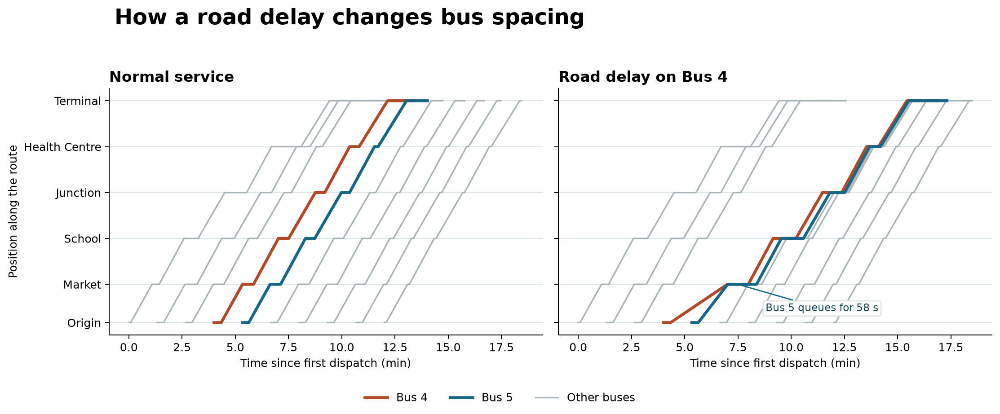
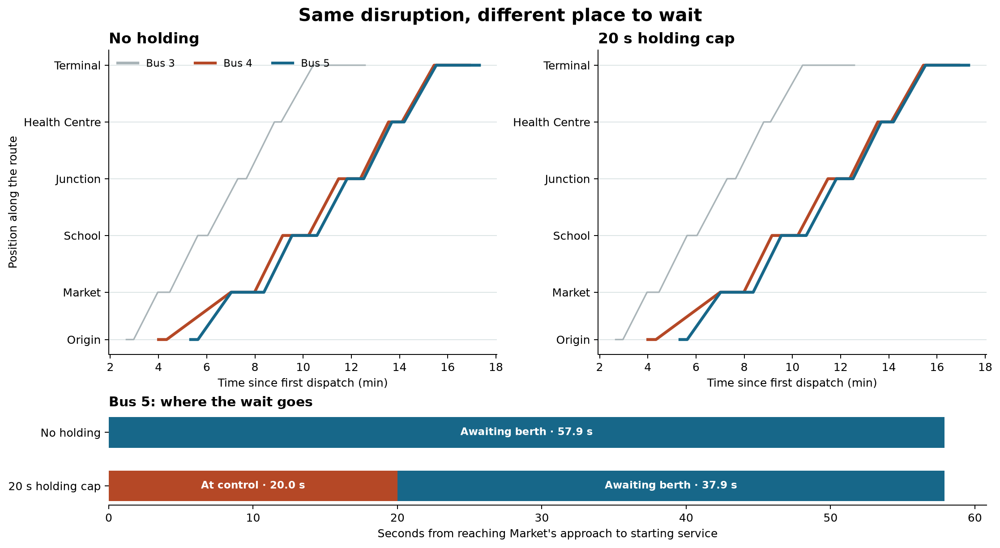
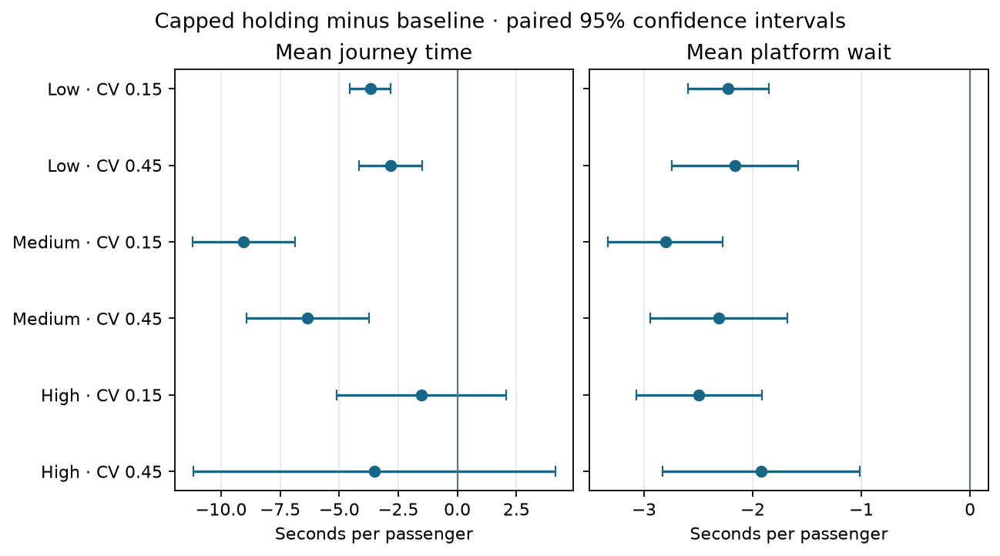

# Bus Corridor Simulator

Trace how delays spread between buses on a straight urban road, and measure what passengers experience.

[Open the live demo](https://amri0faz31.github.io/bus-corridor-simulator/)

## Corridor and reference run

Origin → Market → School → Junction → Health Centre → Terminal. The example dispatches ten buses along five links. Passengers board at five stops, travel to assigned downstream destinations, and add to dwell as they board or alight. Stop names, distances, demand and running times specify a synthetic scenario.

The notebook compares normal operation with a temporary delay to Bus 4. The same passenger trips and bus schedule feed both runs.

## Quick start

Open [the notebook](notebook/bus-corridor-simulator.ipynb) in Google Colab via **File → Upload notebook**, then select **Runtime → Run all**. In local Jupyter, install the dependencies in `requirements.txt` first. Running the figure cell writes the plot to `figures/` under the current working directory.

## Verification

The one-berth fixture checks a 20-second bus wait and FIFO ordering when a berth releases at the same time a bus arrives. A second hand calculation verifies two complete passenger journeys and two consecutive berth queues. The same engine runs both checks and the six-stop example. A separate test checks the cap and FIFO holding queue. A zero cap reproduces both original runs exactly. The common engine also passes analytical M/M/1 and fixed-headway waiting checks. See the [verification table and delay accounting](VERIFICATION.md).

## Model and concepts applied

A next-event clock handles movements, berth ownership and passenger queues. Stops use a linear boarding/alighting dwell model. Service and passenger events provide the time–distance plot and summary measures. See [model equations, assumptions and planned experiments](THEORY.md).

## Results

In the reference run, the 100-second delay raises mean platform wait from 64.6 to 83.7 seconds across the same 296 passengers. Bus 5 queues for 57.9 seconds at Market. Mean passenger journey time rises from 327.8 to 382.2 seconds. The reference run is deterministic.

With the same road delay, Bus 5 spends 57.9 s waiting for the Market berth with immediate release and 37.9 s with the cap. The controller holds that bus for 20.0 s. Across the same 296 passengers, mean platform wait is 83.74 s without holding and 84.28 s with the cap. Mean journey times are 382.18 s and 382.63 s, respectively. These are results for one fixed scenario.

With an 80-second target and a 20-second cap, the paired 95% journey-time interval favoured holding in five scenarios. The interval for high demand and CV 0.15 crossed zero. Platform waiting fell in all six comparisons, by 1.29–2.51 seconds per passenger on average. At high demand and CV 0.45, holding added 1.63 seconds of deliberate onboard delay per passenger while reducing mean total journey time by 8.65 seconds. The earlier single road shock still shows a case where the queue shrank while passenger time increased.

[Results and exports](RESULTS.md) · [Experiment design](EXPERIMENT_PLAN.md)

## Browser

Open [docs/index.html](docs/index.html) locally in Chrome, Edge, or Firefox. The page runs client-side and includes a fixed case checked against the notebook. See the [user guide](USER_GUIDE.md) for controls and verification commands.

## References, AI assistance and licence

[References](REFERENCES.md) · [Data sources](data/README.md) · [MIT licence](LICENSE)

AI assisted with planning, starter code and documentation. The notebook contains reproducible calculations and executable checks.
