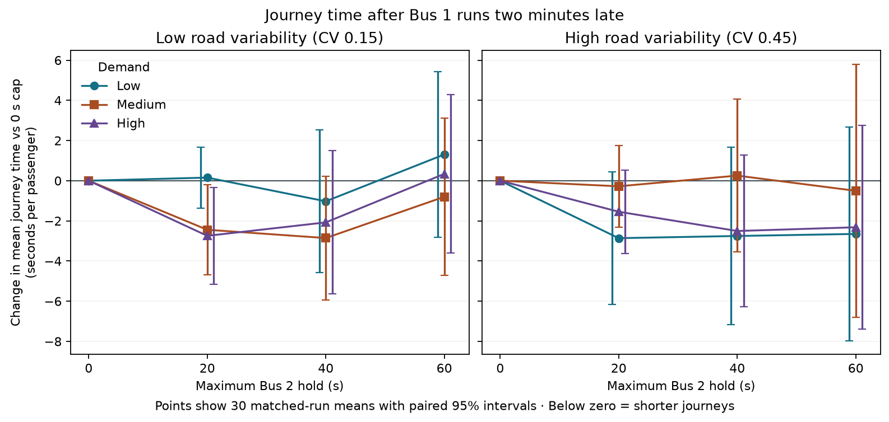

# Boarding, bunching and holding the middle bus

## What happens after a 30-second delay?

Holding is off in this comparison. The fixed-road, free-berth hand check gives a B1–B2 boarding gap of 240 s at Market and School. Delaying Bus 1 reduces each gap to 210 s.

The following are means over 30 matched seeds. Gap changes are delayed minus no-delay.

| Dwell model | Market boardings B1 / B2, before → after | Market dwell B1 / B2, before → after (s) | Market gap change | School gap change |
|---|---|---|---:|---:|
| Fixed | 8.07 / 11.10 → 9.63 / 9.53 | 20.00 / 20.00 → 20.00 / 20.00 | −30.00 s | −30.00 s |
| Passenger-dependent | 7.60 / 11.50 → 9.03 / 10.07 | 22.80 / 33.08 → 25.86 / 30.02 | −30.00 s | −36.12 s |

With passenger-dependent dwell, the late bus picks up more riders at Market and stops longer, while its follower boards fewer and leaves earlier relative to it. The disturbance grows between Market and School in **23 of 30** pairs and passes through unchanged in the other seven. With fixed dwell, it passes through unchanged in all 30. [Propagation records](data/disturbance-propagation.csv)

## How much holding helps after a two-minute delay?

Each point compares two cap settings on the same 30 passenger manifests and road matrices. Below zero means shorter journeys. The bars are pointwise paired 95% intervals on the mean difference in seconds per passenger. The zero-cap point is the reference. Lines connect only the four tested settings. [All direct paired contrasts](data/policy-effects.csv)

At low road variability, a 20-second cap saved **2.44 s** per passenger at medium demand (95% interval **0.20 to 4.68 s saved**) and **2.75 s** at high demand (**0.34 to 5.15 s saved**). At low demand the change was +0.15 s [−1.37, +1.68]. Moving from 20 to 40 s had an uncertain effect at every demand and variability. Moving from 40 to 60 s **lengthened** journeys under low variability by **2.33 s** at low demand [0.69, 3.97], **2.05 s** at medium demand [0.78, 3.32], and **2.41 s** at high demand [1.00, 3.83]. These incremental comparisons use within-run differences between adjacent caps.

At high road variability, every adjacent-cap interval included zero, as did every comparison with the zero cap. The data offer little basis for choosing a cap there. For example, at low demand and high variability, increasing from 20 to 40 s changed the estimated mean by only +0.11 s [−1.97, +2.18].

**Lowest estimated journey time among the four tested caps.** For low, medium and high demand respectively, the lowest estimates occurred at **40, 40 and 20 s** under low road variability, and **20, 60 and 40 s** under high variability. Each sample had a single numerical minimum. The direct paired intervals leave alternative caps plausible in every scenario. Searching across caps and scenarios adds selection uncertainty.

**When different caps do the same thing.** Under high variability, raising the cap from 40 to 60 s produced the same actual hold in **1, 6 and 5 of 30 runs** at low, medium and high demand, respectively. The controller releases Bus 2 once the gap is restored, even if time remains under the cap. Every adjacent cap change altered the actual hold in all low-variability runs.

## Why the platform and onboard effects differ

Medium demand, road CV 0.15, 30 matched sets. Time changes are relative to zero holding in seconds per passenger. The last two columns count riders per run whose manifest ID moved from Bus 3 to Bus 2 at that stop. Fractions are averages over runs. [Table data](data/default-cap-mechanism.csv)

| Cap (s) | Mean actual hold (s) | Platform wait change | Onboard time change | Journey time change | Market B3 → B2 | School B3 → B2 |
|---:|---:|---:|---:|---:|---:|---:|
| 0 | 0 | 0.00 | 0.00 | 0.00 | 0.00 | 0.00 |
| 20 | 20 | −3.37 | +0.93 | −2.44 | 0.83 | 1.10 |
| 40 | 40 | −5.22 | +2.36 | −2.86 | 1.80 | 2.03 |
| 60 | 60 | −4.98 | +4.18 | −0.80 | 2.47 | 2.80 |

At 60 s, the largest number of riders caught the earlier bus, yet the platform saving no longer grew and onboard time rose. Other platform passengers also wait longer when Bus 2 boards later. The 40-second cap had the lowest estimated journey time here, but extending 20 to 40 s saved only 0.41 s on average (paired difference −0.41 s [−2.57, +1.75]).

## A single replay can go the other way

In the default browser replay, all **75** riders completed. With a 20-second hold, **one School rider** switched to Bus 2. School’s gaps changed from 123.10 and 270.29 s to 143.10 and 250.29 s. Platform wait fell by 0.40 s per passenger, onboard time rose by 2.44 s, and journeys took **2.04 s longer**. Across the six scenarios, the 20-second cap shortened journeys in 92 matched runs, lengthened them in 76, and left the mean unchanged in 12 (within numerical tolerance). [Individual outcomes](figures/paired-policy-effects.png) · [Run records](data/paired-replications.csv)

**Most important limitation.** Each stop closes admissions at Bus 3’s earliest free-running arrival. This guarantees the cohort can finish, but excludes people who would reach the stop later, including some who could still catch a delayed Bus 3. The measured trade-off applies to this three-bus service window. A continuing route could serve a different group and yield a different cap ranking.
