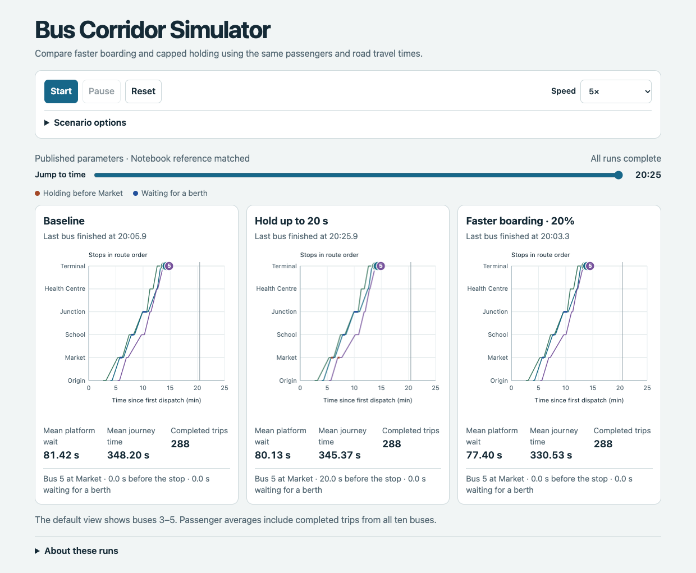
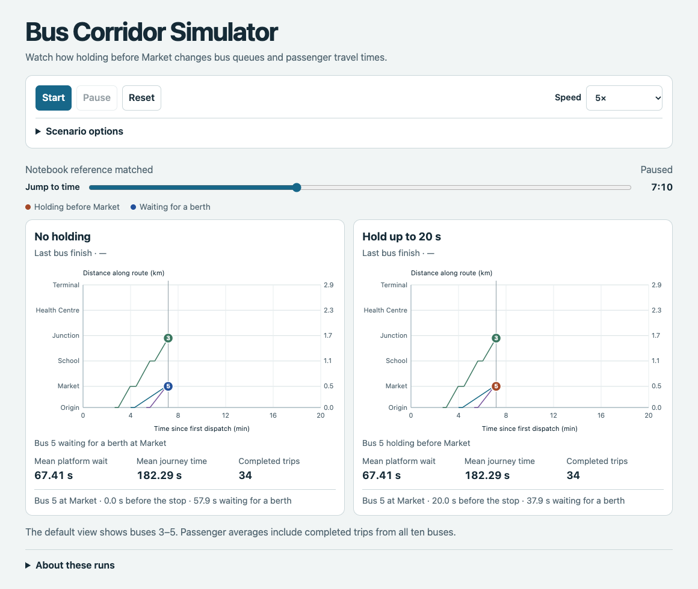

# User guide

Open [the live demo](https://amri0faz31.github.io/bus-corridor-simulator/) or open `docs/index.html` locally. **Start**, **Pause** and **Reset** control the charts on a shared clock. Choose **1× · real time** for one simulated second per real second. Drag **Jump to time** to inspect a later event or the completed run.

## Three-policy replay

The default opens **Published-parameter replay**. The panels use the same passengers and road draws. Baseline runs normally, capped holding spaces releases before Market and faster boarding reduces seconds per boarding passenger by 20% at all stops. The vertical axis shows stops in route order. Blue marks waiting for a berth. Orange marks a hold. The chart shows buses 3–5 by default, and every completed trip contributes to the passenger averages.

At the end of this fixed replay, all three panels complete 288 trips. Mean journey time is **348.20 s** for baseline, **345.37 s** for holding and **330.53 s** for faster boarding. The browser checks completed trips, mean platform wait, mean journey time and Bus 5's Market berth wait against Python using a tolerance of 0.0000001 seconds for timings.

Change demand, travel-time variability or the hold cap under **Scenario options** to run one browser-seeded preview with the published link means. The full notebook experiment uses 30 matched replications per scenario and fixes the cap at 20 s.

## Original road disruption

In **Scenario options**, select **Original road disruption** for the two-policy illustration with the original synthetic distances. Jump to about **7:10** to see Bus 5 held upstream with holding or waiting for a berth in the baseline. Both panels complete 296 trips. Mean journey time in this case is **382.18 s** without holding and **382.63 s** with holding.

## Reproduce and verify

- Run the [notebook](notebook/bus-corridor-simulator.ipynb) to recreate the CSVs, reference values and plots.
- Run `node tests/check-demo.cjs` to check both notebook references, zero boarding improvement and the preview controls.
- Run `python tests/check-results.py` to execute the whole notebook in a temporary directory and compare the numeric exports.
