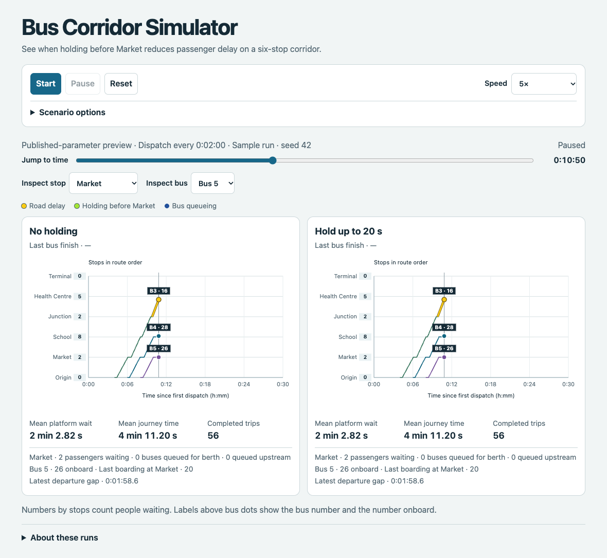

# User guide

Open [the live demo](https://amri0faz31.github.io/bus-corridor-simulator/) or open `docs/index.html` locally. **Start**, **Pause** and **Reset** run both panels on one clock. **Jump to time** lets you inspect a particular event. The clock uses hours, minutes and seconds. Choose **1× · real time** to advance one simulated second per real second.

## Compare no holding and capped holding

The default preview uses the published link means, sampled traffic variability and a **2 min** initial dispatch gap. The longer gap separates early bus departures visually. Both panels share it, and the holding rule still targets a **1 min 20 s** release gap before Market. The notebook experiment and both reference replays retain **1 min 20 s** dispatches.

Choose **Inspect stop** and **Inspect bus**. Each panel shows platform passengers waiting, the berth queue, and the number onboard the selected bus. At Market it also shows buses queued at the control point. The latest departure gap measures the time between the last two departures at the selected stop. The chart shows buses 3–5 initially. The number beside each stop is its current passenger queue. A label such as B5 · 6 shows Bus 5 carrying six passengers. The dot stays on the trail, and a leader line connects its label when nearby buses need more room. Finished buses leave their trails on the chart.

Platform wait is the mean wait of passengers who have boarded by the current time. Journey time uses completed passengers. Both averages include every bus. Counts change at event times, and boarding and alighting happen at the start of service in the model.

## Read the time–distance chart

A rising trail is a bus travelling between stops. A flat trail is a bus spending time at a stop or on its approach. The vertical line shows the current simulation time. Yellow highlights the road leg affected by the injected disruption or the no-passing rule. Light green marks deliberate holding before Market, and blue marks queueing. Bus positions between stops are interpolated from the simulated departure and arrival times.

## Reference replays

- **Published-parameter replay** uses the notebook's short reference case. All 288 passengers complete. Mean journey time is **5 min 48.20 s** without holding and **5 min 45.37 s** with holding.
- **Original road disruption** shows the original deterministic two-policy example. At **0:07:10**, Bus 5 waits for the berth without holding and is held before Market under capped holding. Both panels complete 296 trips.
- **Include faster boarding comparison** adds the supplementary third panel in the published scenario. It assumes 20% less time per boarding passenger at all stops.

The browser checks the two references against Python for completed trips, mean platform wait, mean journey time and Bus 5's Market berth wait. The timing tolerance is 0.0000001 seconds. The live preview is one matched sample. The notebook runs 30 matched replications per scenario.

## Reproduce the results

- Run the [notebook](notebook/bus-corridor-simulator.ipynb) to regenerate the CSVs, reference values and figures.
- Run `node tests/check-demo.cjs` to verify the notebook replays, passenger and queue counts, and all three dispatch-gap settings.
- Run `python tests/check-results.py` to execute the full notebook in a temporary directory and compare its numeric exports.
